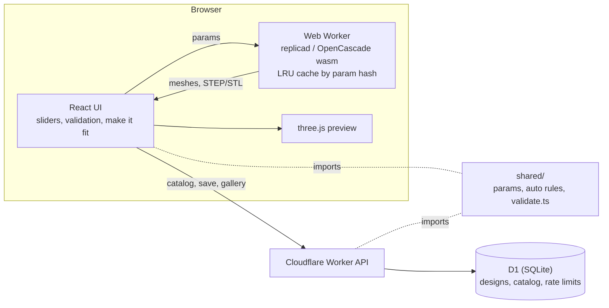

# Part Generator

Parametric 3D-printable parts in the browser. Change a few dimensions, watch
the model update, download STEP or STL.

**Live:** https://bdubs784.github.io/part_generator/


The first part is the printed ball bearing from the base (tower) joint of my
5-DOF robot arm: two rings with 45° V-groove races for steel balls, a fill
notch to snap the balls in, and bolt holes. The tool started as a port of the
CadQuery script I used for those rings, and with the tower preset it still
produces the same rings (volumes match the CadQuery STEP files to 0.005 mm³).

## What it does

- **Few inputs, the rest worked out.** Set the OD, bore, ball size and play;
  thickness, ball circle, groove, notch, bolt circles and ball count follow.
  Any of those can be overridden.
- **Can't make an unprintable part by dragging.** Every slider only covers
  values that pass validation with everything else held, and the limits are
  shown under it.
- **Make it fit.** Type a value the current design can't do (say a 45 mm OD)
  and the tool adjusts the values you haven't touched, then tells you what it
  changed.
- **Shafts:** round, D-flat or hex bores, with a fit allowance for the printer.
- **Standard sizes:** pick a 608, 6205, etc. and it fills in the real bore,
  OD and width, then fits the balls and holes to them.
- **Share links and a gallery** of designs other people saved, with download
  counts.
- **Finishing:** edge chamfers (for elephant's foot and a lead-in), counterbored
  bolt holes sized for socket head screws, and an optional outer flange.
- Undo/redo, section view, STEP and STL per ring.

## How the bearing is built

Each ring is a 2D cross-section revolved around the axis.

```
        outer ring                 r + |y| = A   (outer race flank)
    ┌───────────────┐
    │      ___      │
    │     /   \     │  45° V-groove, flat at the bottom
    │    |  ●  |    │  ● ball, touching both flanks
    │     \___/     │
    └───────────────┘
        inner ring                 r − |y| = B   (inner race flank)
```

A ball touching both 45° flanks of a V sits √2·r from the V's apex, so with
two races the flank lines are `A − B = 2√2·r + play` apart, centred on the
ball circle. Because the flanks are at 45°, axial play equals radial play.
Each groove is truncated with a small flat, which has to stay clear of the
ball: along the groove's centre line the ball stops `(√2 − 1)·r` short of the
apex, so `flat < 2·((√2 − 1)·r + play/2)`.

The rings' lands sit halfway between the ball's contact point and the face, so
the ball rolls on the flank and the lips stay printable. Balls go in through a
notch in the bottom face of both rings; lined up, the two notches leave a
channel just wider than a ball.

## Validation rules

All in `shared/validate.ts`, shared by the UI and the API. Errors block the
preview, the downloads and saving:

- diameters step outward: bore < inner ring OD < outer ring ID < OD
- walls ≥ 1.2 mm (three 0.4 mm perimeters), groove lips ≥ 0.6 mm
- a centred ball can't overlap either ring anywhere (flat, flanks, lips)
- the ball touches the flanks, not a lip edge
- bolt holes stay a wall away from the bore, the OD, the groove and each other
- ball count ≤ what fits on the ball circle (with 0.1 mm between balls)
- play ≥ 0 unless "Allow negative play" is on; with it, the ball may sink into
  each flank by exactly its share of the play

Warnings (it still builds): narrow fill notch, negative play.

## Architecture



- Geometry stays in the browser. OpenCascade runs in a Web Worker so the page
  never freezes, and repeat builds come out of a cache keyed by the parameters.
- `shared/` has no CAD imports, so the same validation runs in the UI and the
  Worker. The server never trusts the client.
- The site is static on GitHub Pages; the API is a Cloudflare Worker with D1.

Design notes and trade-offs: [docs/DECISIONS.md](docs/DECISIONS.md).

## API

Base URL: `https://part-generator-api.blainewatkins784.workers.dev`. Browser
requests are only accepted from this site and localhost.

| Method | Path | |
|---|---|---|
| `GET` | `/api/health` | `{ ok, catalog }` |
| `GET` | `/api/catalog/bearings` | standard sizes: `{ bearings: [{ designation, bore_mm, od_mm, width_mm, notes }] }` |
| `POST` | `/api/designs` | body `{ part_type: "bearing", params }`, validated with the same rules as the UI. Returns `{ id, url }`: 201 if new, 200 if that exact design was already saved |
| `GET` | `/api/designs/:id` | `{ id, part_type, schema_ver, params, created_at, downloads }` |
| `GET` | `/api/designs?sort=recent&limit=20&before=…` | newest first, `{ designs, next }`; pass `next` as `before` for the next page |
| `POST` | `/api/designs/:id/download` | counts a download, 204 |

Errors are JSON `{ error, issues? }`: 400 invalid params, 404 not found,
413 body too large, 429 rate limited (20 saves per 10 minutes per IP).

```sh
curl https://part-generator-api.blainewatkins784.workers.dev/api/designs?limit=1
```

## Performance

Measured on my laptop, October 2026. Headless Chromium for the browser numbers,
`curl` for the API.

| What | Result |
|---|---|
| Build both rings (cache miss, default bearing) | median **462 ms** (n=20, 452–500), about 230 ms per ring including meshing |
| Same build from the cache | **< 1 ms** in the worker (n=10) |
| First build after the CAD kernel loads | 701 ms (inner ring 479 ms, includes wasm warm-up) |
| Live site: page drawn / first model on screen (cold cache) | 3.3 s / 6.6 s, mostly the 7.3 MB (gzipped) OpenCascade wasm |
| API, `GET` endpoints (new TLS connection each time) | median 155–165 ms, p95 under 205 ms (n=25 each) |
| API, `POST /api/designs` | median 240 ms (n=10) |

The TLS handshake is ~90 ms of each API request from here, so the Worker plus
D1 part is roughly 70 ms.

## Tests

- **Unit (Vitest):** validation rules, auto values, slider limits, make it fit,
  geometry (volumes match the CadQuery rings, OpenCascade validity check on
  every variant, hex and D-flat volumes against hand calculations), the
  geometry cache, and the API handlers against real SQL (`node:sqlite` running
  the D1 migrations).
- **End to end (Playwright):** loads the site and a local Worker + D1, then
  drives the real UI: sliders, make it fit, undo, standard sizes, share link
  round trip, gallery, download counting, STEP/STL downloads.
- CI runs lint, typecheck and both suites on every push; `main` deploys the
  site to Pages and the API to Cloudflare only if they pass.

## Development

```sh
npm install
npm run dev                 # http://localhost:5173/part_generator/
npm test                    # unit tests
npm run test:e2e            # Playwright (starts the site and a local API)
npm run lint

npm run api:migrate:local   # once: create the local D1 tables
npm run api:dev             # Worker on http://127.0.0.1:8787
```

## Roadmap

- [x] Bearing with live preview, validation, STEP/STL download
- [x] Auto-derived dimensions, slider limits, make it fit
- [x] Standard sizes and share links (Cloudflare Worker + D1)
- [x] Geometry in a Web Worker with a parameter cache
- [x] Gallery of shared designs with download counts
- [x] Edge chamfers, counterbored bolt holes, outer flange
- [ ] Spur gear, MG996R servo mount
- [ ] Geometry engine in C++/WebAssembly (Manifold), benchmarked against this one
